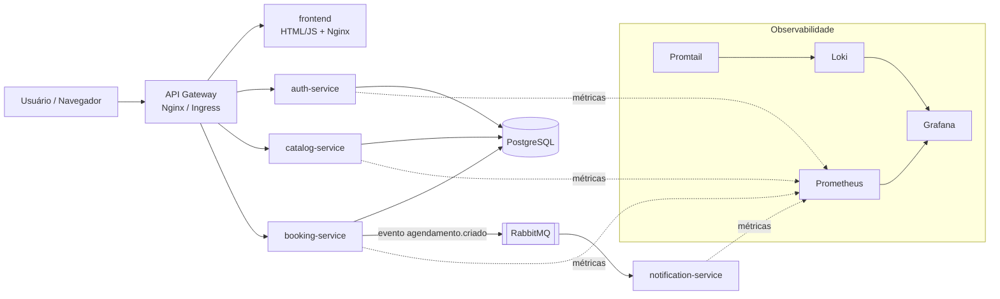

# agenda-cloud-microservices

Sistema de agendamento para pequenos negócios (salões, clínicas, barbearias) em arquitetura de micro serviços com Docker/Kubernetes, PostgreSQL, RabbitMQ e observabilidade com Prometheus, Grafana e Loki. Projeto da disciplina de Arquiteturas de Computação em Nuvem.

> Apresentação: **04/12/2026**

---

## Sumário

0. [RACI da equipe](docs/RACI.md)
1. [Cenário e problema](#1-cenário-e-problema)
2. [Requisitos e funcionalidades](#2-requisitos-e-funcionalidades)
3. [Arquitetura da solução](#3-arquitetura-da-solução)
4. [Fluxos da aplicação](#4-fluxos-da-aplicação)
5. [Alta disponibilidade e escalabilidade](#5-alta-disponibilidade-e-escalabilidade)
6. [Monitoramento e observabilidade](#6-monitoramento-e-observabilidade)
7. [Estrutura do repositório](#7-estrutura-do-repositório)
8. [Como executar](#8-como-executar)
9. [Evidências (logs e dashboards)](#9-evidências-logs-e-dashboards)

---

## 1. Cenário e problema

Pequenos negócios de serviços (salões de beleza, barbearias, clínicas de estética) ainda controlam a agenda por WhatsApp, telefone ou caderno. Isso gera:

- conflitos de horário e agendamentos duplicados;
- clientes que esquecem o horário (faltas sem aviso);
- tempo do profissional gasto respondendo mensagens em vez de atendendo;
- nenhuma visão de ocupação ou faturamento.

**Solução:** uma plataforma web onde o cliente vê os horários livres e agenda sozinho, recebe confirmação e lembrete, e o estabelecimento gerencia serviços, profissionais e a agenda em um painel.

## 2. Requisitos e funcionalidades

### Funcionais
| ID | Funcionalidade | Serviço responsável |
|----|----------------|---------------------|
| RF01 | Cadastro e login de usuários (cliente e administrador) | `auth-service` |
| RF02 | Cadastro de serviços (nome, duração, preço) e profissionais | `catalog-service` |
| RF03 | Consulta de horários disponíveis por profissional/serviço | `booking-service` |
| RF04 | Criar, remarcar e cancelar agendamentos | `booking-service` |
| RF05 | Notificação de confirmação, cancelamento e lembrete 24h antes (e-mail simulado) | `notification-service` |
| RF06 | Painel administrativo com agenda do dia | `frontend` |

### Não funcionais
- **Disponibilidade:** múltiplas réplicas por serviço, sem ponto único de falha na camada de aplicação.
- **Escalabilidade:** escala horizontal automática (HPA) com base em CPU.
- **Observabilidade:** métricas, logs centralizados e dashboards.
- **Segurança:** autenticação via JWT, senhas com hash (bcrypt), segredos em `Secret`/`.env`.

## 3. Arquitetura da solução

> Desenho detalhado: [`docs/arquitetura.md`](docs/arquitetura.md)



### Camadas
| Camada | Componentes |
|--------|-------------|
| Frontend | SPA em HTML/CSS/JavaScript puro servida por Nginx |
| API Gateway | Nginx: ponto único de entrada, roteia `/api/*` e balanceia entre réplicas |
| Backend | Micro serviços em Node.js 22 (Express 5): `auth`, `catalog`, `booking`, `notification` |
| Mensageria | RabbitMQ (exchange `agenda`, fila `notifications` com dead-letter queue) |
| Banco de dados | PostgreSQL 16 (um schema por serviço: `auth`, `catalog`, `booking`, `notif`) |
| Infraestrutura | Docker Compose (dev/demo) e Kubernetes (k3d) com HPA |
| Observabilidade | Prometheus, Grafana, Loki, Promtail, postgres-exporter, nginx-exporter |

### Micro serviços e rotas

| Serviço | Rotas (via gateway) | Responsabilidade |
|---------|---------------------|------------------|
| `auth-service` | `POST /api/auth/register`, `POST /api/auth/login`, `GET /api/auth/me` | usuários, senhas (bcrypt) e emissão de JWT |
| `catalog-service` | `GET/POST /api/catalog/services`, `GET/POST /api/catalog/professionals` | serviços oferecidos e profissionais |
| `booking-service` | `GET /api/bookings/availability`, `POST /api/bookings/`, `GET /api/bookings/me`, `PATCH /api/bookings/:id/cancel` | horários livres e agendamentos; publica eventos |
| `notification-service` | `GET /api/notifications/` | consome eventos, envia confirmações e lembretes |

Todos expõem `/health` (liveness), `/ready` (readiness, testa o banco) e `/metrics` (Prometheus). O gateway bloqueia essas rotas para acesso externo.

**Comunicação:**
- **Síncrona (HTTP):** `booking-service` consulta o `catalog-service` para validar serviço e profissional.
- **Assíncrona (eventos):** `booking-service` publica `booking.created` e `booking.cancelled`, e o `notification-service` consome. Se o notificador estiver fora, os eventos esperam na fila.
- **Autenticação distribuída:** o `auth-service` emite o JWT e os outros serviços validam a assinatura localmente, sem chamar o `auth-service` a cada requisição.

## 4. Fluxos da aplicação

### Agendamento
1. Cliente faz login → `auth-service` devolve um JWT.
2. Frontend lista serviços e profissionais → `catalog-service`.
3. Cliente escolhe data → `booking-service` calcula horários livres.
4. Cliente confirma → `booking-service` grava no PostgreSQL e publica `agendamento.criado` no RabbitMQ.
5. `notification-service` consome o evento e envia a confirmação (log/e-mail simulado).
6. A cada minuto, o `notification-service` envia lembretes dos agendamentos que começam nas próximas 24h.

### Concorrência
Duas pessoas podem tentar o mesmo horário ao mesmo tempo, em réplicas diferentes. O `booking-service` usa um *advisory lock* do PostgreSQL por profissional dentro da transação: só uma reserva vence, e a outra recebe `409`. Os lembretes usam `FOR UPDATE SKIP LOCKED`, então duas réplicas nunca enviam o mesmo lembrete.

*(diagramas de sequência em [`docs/arquitetura.md`](docs/arquitetura.md))*

## 5. Alta disponibilidade e escalabilidade

- **Réplicas:** cada micro serviço roda com no mínimo 2 réplicas (`Deployment.replicas: 2`).
- **Auto scaling:** `HorizontalPodAutoscaler` escalando de 2 até 5 pods com CPU > 70%.
- **Health checks:** `livenessProbe` e `readinessProbe` em `/health`; pods com falha são reiniciados e retirados do balanceamento.
- **Balanceamento:** `Service` do Kubernetes distribui requisições entre as réplicas; Ingress/Nginx como ponto de entrada.
- **Serviços stateless:** estado fica no PostgreSQL e no RabbitMQ, permitindo matar e recriar pods sem perda.
- **Desacoplamento:** se o `notification-service` cair, os eventos ficam na fila e são processados quando ele voltar.
- **Rolling update:** deploys sem downtime (`strategy: RollingUpdate`).
- **Em produção (cenário):** cluster gerenciado (EKS/AKS/GKE) em múltiplas zonas, banco gerenciado com réplica (RDS Multi-AZ).

## 6. Monitoramento e observabilidade

| Pilar | Ferramenta | Como |
|-------|-----------|------|
| Métricas | Prometheus + `prom-client` | cada réplica expõe `/metrics`; o Prometheus descobre as réplicas por DNS (`dns_sd_configs`) |
| Métricas de infra | postgres-exporter, nginx-exporter, plugin Prometheus do RabbitMQ | conexões no banco, tráfego do gateway, tamanho das filas |
| Logs | Loki + Promtail | logs estruturados em JSON (pino) lidos do Docker; o nível do log (`level`) vira label |
| Dashboards | Grafana (provisionado automaticamente) | dashboard "Agenda Fácil: visão geral" |
| Alertas | Regras do Prometheus ([alerts.yml](observability/prometheus/alerts.yml)) | instância fora do ar, réplicas abaixo de 2, erro 5xx > 5%, p95 > 500 ms, fila acumulando, eventos na DLQ |

### Métricas expostas pela aplicação

| Métrica | Tipo | Serviço |
|---------|------|---------|
| `http_requests_total{method,route,status_code}` | counter | todos |
| `http_request_duration_seconds` | histogram | todos |
| `auth_logins_total{result}`, `auth_registrations_total` | counter | auth |
| `bookings_created_total`, `bookings_cancelled_total`, `booking_conflicts_total` | counter | booking |
| `catalog_request_duration_seconds` | histogram | booking (chamada ao catalog) |
| `events_published_total{routing_key,result}` | counter | booking |
| `notifications_sent_total{type}`, `events_failed_total` | counter | notification |
| `notification_delivery_lag_seconds` | histogram | notification |
| métricas padrão do processo (CPU, memória, event loop) | vários | todos |

### Dashboard

O dashboard ([agenda-overview.json](observability/grafana/dashboards/agenda-overview.json)) tem:
- **Visão geral:** instâncias no ar, req/s, taxa de erro, latência p95, agendamentos e notificações
- **Tráfego:** req/s e p95 por serviço, respostas por código HTTP, requisições por réplica (mostra o balanceamento)
- **Negócio:** agendamentos, cancelamentos e conflitos; notificações por tipo
- **Infra:** fila do RabbitMQ, atraso evento→notificação, conexões no PostgreSQL, CPU e memória por réplica
- **Logs:** logs do Loki filtráveis por serviço e contagem de warn/error

## 7. Estrutura do repositório

```
.
├── docker-compose.yml    # ambiente completo (app + dados + observabilidade)
├── docs/                 # RACI, arquitetura, evidências
├── frontend/             # SPA (HTML/CSS/JS) + Nginx
├── gateway/              # API Gateway (Nginx)
├── services/
│   ├── auth-service/
│   ├── catalog-service/
│   ├── booking-service/
│   └── notification-service/
├── infra/
│   └── k8s/              # manifests Kubernetes (Deployments, HPA, PDB, StatefulSets)
├── observability/
│   ├── prometheus/       # scrape e regras de alerta
│   ├── loki/ promtail/   # logs
│   └── grafana/          # datasources e dashboard provisionados
└── scripts/
    └── gerar-trafego.mjs # gera carga para métricas e dashboards
```

Cada serviço tem sua própria cópia de `src/lib/` (logs, métricas, JWT). A cópia é intencional: os micro serviços são independentes e não compartilham build.

## 8. Como executar

Pré-requisito: [Docker Desktop](https://www.docker.com/products/docker-desktop/).

```bash
docker compose up -d --build
docker compose ps
```

| O quê | Endereço | Acesso |
|-------|----------|--------|
| Aplicação | http://localhost:8080 | admin: `admin@agenda.local` / `admin123`, ou crie uma conta |
| Grafana | http://localhost:3000 | `admin` / `admin` |
| Prometheus | http://localhost:9090 | Status → Targets mostra as 8 réplicas |
| RabbitMQ | http://localhost:15672 | `agenda` / `agenda` |

Para gerar tráfego e popular os dashboards (precisa do Node 18 ou mais novo):

```bash
node scripts/gerar-trafego.mjs --minutos 5 --concorrencia 10
```

Para testar a alta disponibilidade no Compose:

```bash
docker compose stop notification-service   # os eventos ficam na fila do RabbitMQ
docker compose start notification-service  # as notificações pendentes são processadas
docker compose up -d --scale booking-service=4 --no-recreate
```

Para rodar no Kubernetes, veja [infra/k8s/README.md](infra/k8s/README.md).

## 9. Evidências (logs e dashboards)

Logs reais da aplicação rodando no Docker Compose, gerados com `scripts/gerar-trafego.mjs`, estão em [`docs/evidencias/`](docs/evidencias/):

| Arquivo | Conteúdo |
|---------|----------|
| `logs-gateway.log` | acessos em JSON com status, tempo e réplica que atendeu (`upstream`) |
| `logs-*-service.log` | logs estruturados de cada micro serviço |
| `logs-notificacoes-eventos.log` | confirmações, cancelamentos e lembretes disparados por eventos do RabbitMQ |
| `prometheus-targets.txt` | as 8 réplicas e os exporters coletados pelo Prometheus |

Testes de alta disponibilidade feitos:
- **Notificador desligado:** os eventos ficaram na fila do RabbitMQ (`consumidores=0`) e foram processados quando o serviço voltou.
- **Réplica derrubada:** com uma das réplicas do `booking-service` parada, todas as requisições seguiram respondendo `200`.
