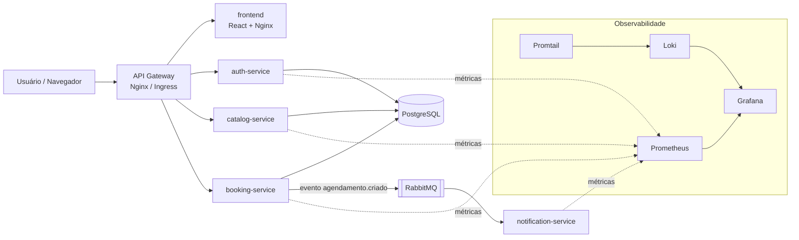

# agenda-cloud-microservices

Sistema de agendamento para pequenos negócios (salões, clínicas, barbearias) em arquitetura de micro serviços com Docker/Kubernetes, PostgreSQL, RabbitMQ e observabilidade com Prometheus, Grafana e Loki. Projeto da disciplina de Arquiteturas de Computação em Nuvem.

> Apresentação: **04/12/2026**

---

## Sumário

0. [RACI da equipe](docs/RACI.md)
1. [Cenário e problema](#1-cenário-e-problema)
2. [Requisitos e funcionalidades](#2-requisitos-e-funcionalidades)
3. [Arquitetura da solução](#3-arquitetura-da-solução)
4. [Fluxos da aplicação](#4-fluxos-da-aplicação)
5. [Alta disponibilidade e escalabilidade](#5-alta-disponibilidade-e-escalabilidade)
6. [Monitoramento e observabilidade](#6-monitoramento-e-observabilidade)
7. [Estrutura do repositório](#7-estrutura-do-repositório)
8. [Como executar](#8-como-executar)
9. [Evidências (logs e dashboards)](#9-evidências-logs-e-dashboards)

---

## 1. Cenário e problema

Pequenos negócios de serviços (salões de beleza, barbearias, clínicas de estética) ainda controlam a agenda por WhatsApp, telefone ou caderno. Isso gera:

- conflitos de horário e agendamentos duplicados;
- clientes que esquecem o horário (faltas sem aviso);
- tempo do profissional gasto respondendo mensagens em vez de atendendo;
- nenhuma visão de ocupação ou faturamento.

**Solução:** uma plataforma web onde o cliente vê os horários livres e agenda sozinho, recebe confirmação e lembrete, e o estabelecimento gerencia serviços, profissionais e a agenda em um painel.

## 2. Requisitos e funcionalidades

### Funcionais
| ID | Funcionalidade | Serviço responsável |
|----|----------------|---------------------|
| RF01 | Cadastro e login de usuários (cliente e administrador) | `auth-service` |
| RF02 | Cadastro de serviços (nome, duração, preço) e profissionais | `catalog-service` |
| RF03 | Consulta de horários disponíveis por profissional/serviço | `booking-service` |
| RF04 | Criar, remarcar e cancelar agendamentos | `booking-service` |
| RF05 | Notificação de confirmação e lembrete (e-mail/simulado) | `notification-service` |
| RF06 | Painel administrativo com agenda do dia | `frontend` |

### Não funcionais
- **Disponibilidade:** múltiplas réplicas por serviço, sem ponto único de falha na camada de aplicação.
- **Escalabilidade:** escala horizontal automática (HPA) com base em CPU.
- **Observabilidade:** métricas, logs centralizados e dashboards.
- **Segurança:** autenticação via JWT, senhas com hash (bcrypt), segredos em `Secret`/`.env`.

## 3. Arquitetura da solução

> Desenho detalhado: [`docs/arquitetura.md`](docs/arquitetura.md)



### Camadas
| Camada | Componentes |
|--------|-------------|
| Frontend | SPA React servida por Nginx |
| Backend | Micro serviços em Node.js (Express): `auth`, `catalog`, `booking`, `notification` |
| Mensageria | RabbitMQ (comunicação assíncrona entre `booking` e `notification`) |
| Banco de dados | PostgreSQL (um schema por serviço) |
| Infraestrutura | Docker Compose (dev) e Kubernetes local (k3d/minikube) |
| Observabilidade | Prometheus, Grafana, Loki, Promtail |

## 4. Fluxos da aplicação

### Agendamento
1. Cliente faz login → `auth-service` devolve um JWT.
2. Frontend lista serviços e profissionais → `catalog-service`.
3. Cliente escolhe data → `booking-service` calcula horários livres.
4. Cliente confirma → `booking-service` grava no PostgreSQL e publica `agendamento.criado` no RabbitMQ.
5. `notification-service` consome o evento e envia a confirmação (log/e-mail simulado).

*(diagramas de sequência em [`docs/arquitetura.md`](docs/arquitetura.md))*

## 5. Alta disponibilidade e escalabilidade

- **Réplicas:** cada micro serviço roda com no mínimo 2 réplicas (`Deployment.replicas: 2`).
- **Auto scaling:** `HorizontalPodAutoscaler` escalando de 2 até 5 pods com CPU > 70%.
- **Health checks:** `livenessProbe` e `readinessProbe` em `/health`; pods com falha são reiniciados e retirados do balanceamento.
- **Balanceamento:** `Service` do Kubernetes distribui requisições entre as réplicas; Ingress/Nginx como ponto de entrada.
- **Serviços stateless:** estado fica no PostgreSQL e no RabbitMQ, permitindo matar e recriar pods sem perda.
- **Desacoplamento:** se o `notification-service` cair, os eventos ficam na fila e são processados quando ele voltar.
- **Rolling update:** deploys sem downtime (`strategy: RollingUpdate`).
- **Em produção (cenário):** cluster gerenciado (EKS/AKS/GKE) em múltiplas zonas, banco gerenciado com réplica (RDS Multi-AZ).

## 6. Monitoramento e observabilidade

| Pilar | Ferramenta | Como |
|-------|-----------|------|
| Métricas | Prometheus + `prom-client` | cada serviço expõe `/metrics` (requisições, latência, erros, agendamentos criados) |
| Logs | Loki + Promtail | logs estruturados em JSON (pino) coletados dos containers |
| Dashboards | Grafana | dashboards de tráfego, latência p95, taxa de erro, recursos e negócio |
| Alertas | Grafana Alerting | ex.: taxa de erro > 5% ou serviço fora do ar |

## 7. Estrutura do repositório

```
.
├── docs/                 # RACI, arquitetura, apresentação, evidências
├── frontend/             # SPA React
├── services/
│   ├── auth-service/
│   ├── catalog-service/
│   ├── booking-service/
│   └── notification-service/
├── infra/
│   ├── docker/           # docker-compose
│   ├── k8s/              # manifests Kubernetes
│   └── terraform/        # IaC (opcional)
└── observability/        # Prometheus, Grafana, Loki
```

## 8. Como executar

> Em construção.

```bash
# desenvolvimento
docker compose -f infra/docker/docker-compose.yml up -d --build
```

## 9. Evidências (logs e dashboards)

> Prints e logs da aplicação em funcionamento ficarão em [`docs/evidencias/`](docs/evidencias/).
